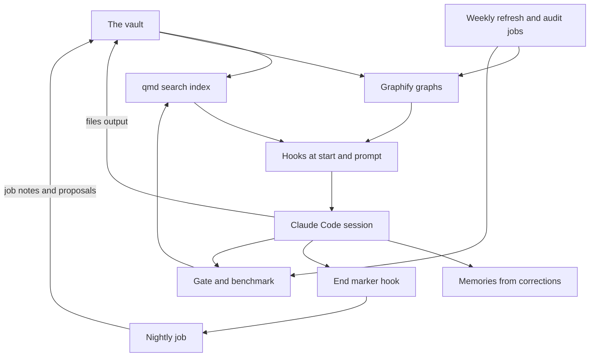

# AI workflows

This repository describes how I run AI agents as a system at home: a personal knowledge base, scheduled jobs and multi-agent review workflows built around Claude Code. Each page is a case study with the numbers I measured.

I manage the system like a product. Every part should have a goal, a measure, a check that fails loud, and a written rule for every mistake I catch. Where a part does not meet that yet, its page says so. One example: the search hook that runs on every prompt still fails silently, and nothing watches for a dead hook.

The system is called Agent OS. It is a single-user setup on my own notes and sessions.

## The system in one picture

Sessions are set up to read before they work things out and to write back what they learned. I measure the reading side: 18 of 33 substantial sessions queried the vault first in the 7 days to 2026-11-01 (55%). An earlier count was 7 of 13 (54%) on 2026-09-14, a baseline I could not verify, so the rate looks flat at best ([01](workflows/01-session-loop.md) has the detail). Hooks put matching page titles in front of the model, a nightly job files what each session learned, weekly jobs refresh the graphs and audit the docs against the disk, and a gate with a retrieval benchmark runs when a session is wrapped up and on a schedule.

## Words I use

- **Session**: one conversation with the coding agent (Claude Code), from start to end.
- **Vault**: my notes, a folder of markdown files that the agents read and write.
- **Hook**: a small script that Claude Code runs by itself at a fixed moment, for example when a session starts.
- **Skill**: a written procedure that the agent loads when a task needs it.
- **Subagent**: a second agent that the main one starts for one narrow job, often on a cheaper model.
- **Gate**: a script with no model in it that checks the system and prints a red line when something is broken.
- **Benchmark**: a fixed set of questions with known right answers. The gate runs it, and it tells me when search gets worse.

## Case studies

| Page | What it shows | The number that matters |
|---|---|---|
| [01 The session loop](workflows/01-session-loop.md) | A seven-step read and write-back loop, moved from a written rule into hooks, a gate and schedules | The written rule was skipped four times before a hook replaced it |
| [02 Retrieval and benchmark](workflows/02-retrieval-and-benchmark.md) | Local search over my notes, a silent ranking decay, and the benchmark that now guards it | On the one failing question: wrong page to right page, 6585 to 2617 tokens |
| [03 The night shift](workflows/03-night-shift.md) | A nightly job that files what my sessions learned, with every claim checked against the transcript in code | 70.0% reachable recall on an 82-item gold set |
| [04 Weekly graph refresh](workflows/04-weekly-graph-refresh.md) | An unattended weekly job with a backup, a shrink guard and a size cap | A refresh once cut the graph from 1082 to 891 nodes; the job now restores the backup when nodes fall more than 2% (edges 5%) beyond what deleted pages owned |
| [05 Gate and audits](workflows/05-gate-and-audits.md) | A no-model gate at wrap-up and every week, and an audit of documented claims against the disk | 41 claims checked in about 30 seconds, 39 passed (2026-09-14) |
| [06 Evaluating my own system](workflows/06-evaluating-my-own-system.md) | A scoreboard against my own goals, a go-live test, and a verified ten-angle code review | 36 defects survived verification; 29 were fixed in the same-day fix session (2026-11-01) |
| [07 Multi-agent review](workflows/07-multi-agent-review.md) | Narrow reviewers in parallel, then a skeptic tries to refute each finding. It includes the review of these repositories before I published them | Two checks, 421 agents: 183 findings confirmed and fixed, 98 refuted or already fixed (2026-11-11) |

Short on time? Read [03](workflows/03-night-shift.md) for one job from problem to rollout, then [06](workflows/06-evaluating-my-own-system.md) for how I audit my own work.

## A design, with no results recorded

- [08 Delivery cycle](workflows/08-delivery-cycle.md): a small private web app built and checked in six agent stages with separate roles.

## Playbook

- [The right model for each step](playbook/model-routing.md): the top model plans and reviews, cheaper models do the work, and since 2026-11-10 the rule is that every agent call names its model.
- [Where the tokens go](playbook/token-economy.md): cost follows the number of tool calls, so I batch calls, check cheaply before dispatching agents and cap what searches return.
- [Corrections that became rules](playbook/operating-rules.md): nine rules my agents follow, each from a dated mistake.

## Scripts and examples

- [Workflow scripts](scripts/README.md): three multi-agent review scripts for the Workflow tool in Claude Code (a pre-push secret scan, a pre-commit privacy review and an adversarial code review), cleaned for publication.
- [Examples](examples/README.md): the global rule file that loads into every session and the hooks block that wires the loop, with personal paths replaced by placeholders.

## How I run it

1. **A rule that only lives in a document gets skipped, so I enforce it with a hook, a gate or a schedule.** See [the session loop](workflows/01-session-loop.md).
2. **I measure instead of trusting the feel.** Search felt like it was getting worse. When I measured it, it looked healthy and still returned the wrong pages. The benchmark now asserts the exact top page. See [retrieval and benchmark](workflows/02-retrieval-and-benchmark.md).
3. **Model output is a claim until code checks it.** Every item the nightly job files must carry a quote that code finds in the transcript. See [the night shift](workflows/03-night-shift.md).
4. **Checks fail loud, and every scheduled job leaves a heartbeat.** A red gate is relayed as it is, never retried into silence. See [gate and audits](workflows/05-gate-and-audits.md).
5. **Every correction I make becomes a written rule, and where a note keeps failing, a check.** See [corrections that became rules](playbook/operating-rules.md).

## What is mine and what is not

I set the goals, the pass bars, the checks and the decisions on every page here, and I read the results and decided what to fix. Claude Code wrote most of the code and most of the text under my direction. The search engine (qmd), the graph builder (Graphify), the notes app (Obsidian), the scheduler (launchd) and Claude Code itself are third-party tools I configured; none of them is my own work.

The code of the system is private because it is tied to my personal notes. These pages describe it, and the [scripts](scripts/README.md) and [examples](examples/README.md) folders hold cleaned copies of the parts that can be shared.

## Limits

- This is a single-user system. It has been tested on one person's notes and sessions.
- Every number here is self-measured on my own data, and costs are list-price estimates, not invoices.
- None of it is a public benchmark. The numbers show what each change did on my setup, not how it would do on anyone else's.
