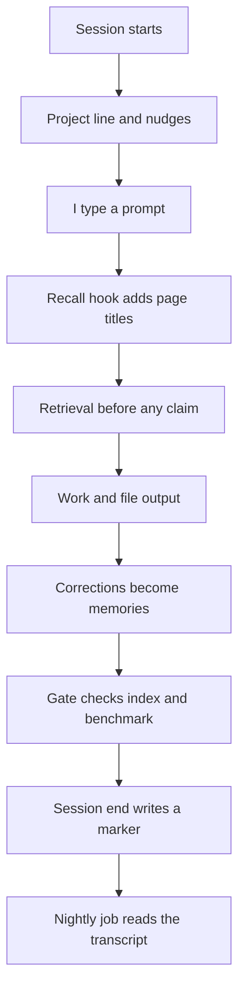

# Read before deriving, write back: the session loop

> A seven-step loop meant to make each Claude Code session read what my knowledge base holds and write back what it learned, enforced by hooks, a gate, schedules and generated facts, because the written rule alone was skipped four times.

## The problem

Every new Claude Code session starts blank. Without help, I re-explain projects, decisions and preferences, and I give the same corrections again. Loading everything at session start wastes tokens on every request.

I keep a personal markdown knowledge base (the vault) and a set of agent memories. They only pay off if a session reads them before it works something out from scratch, and writes back what it learned before it ends. My first answer was a written rule. A written rule turned out to be something a model can argue its way past.

The thesis of this part of Agent OS is simple: a rule that only exists in documentation gets skipped, so the system has to enforce it. Three audits of the setup found the same shape in every defect: a rule correct in the documentation and not true in practice.

## What runs

1. **Session start.** A hook prints one line naming the vault project for the working folder. It adds a nudge line only when something needs attention: undigested inbox drops, a stale map, uncommitted vault changes, or a gate or benchmark that is red or overdue.
2. **Every prompt.** A `UserPromptSubmit` hook runs a keyword (BM25) search over the vault with qmd and prints matching page titles. When the prompt mentions skills, hooks, rules, agents, memory or MCP, it also queries a Graphify graph of my Claude setup. It makes no model call. It stays silent on prompts under 25 characters, on slash commands, and below a 70% match.
3. **Read steps of the loop.** The session treats the project line as an instruction to query first, makes one retrieval call before asserting any defect, gap or fact, and checks a flagged result before calling it triage.
4. **Write steps of the loop.** Durable output is filed into the project folder as it is produced, with its index line and log entry in the same pass. If current truth changed, the project brief is rewritten. A correction from me becomes a memory with `type: feedback` and an index line.
5. **The gate.** The session ends by running one script that updates the search index, regenerates facts, runs the retrieval benchmark and prints OK or FAIL per step. A red gate is relayed verbatim, never retried into silence. The agent then names the steps that are mine, or says there are none.
6. **Session end.** A `SessionEnd` hook writes one marker line and nothing else. A nightly job later reads the marked transcripts, files its own night notes and proposes changes to shared state; it ran first as a propose-only trial and has written live since 2026-11-02.

The rule file itself and the hook wiring are in [../examples/agent-os-loop.md](../examples/agent-os-loop.md) and [../examples/hooks.settings.json](../examples/hooks.settings.json).

### The automation ladder

I sort every recurring step by how it is enforced:

1. Manual
2. Documented (the trap)
3. Nudge
4. Gate
5. Scheduled
6. Self-checking

Three rules go with it. Do not write down a fact a script can read. Every rung above 3 needs a heartbeat. Let the checker read the thing it checks. Work that costs real money or needs judgement stays on rung 1 on purpose.

### Generated facts

Facts a script can read are never typed by hand. A facts script reads the graphs, the search index and the installed tool versions, and writes a table between two markers on one page. It has a `--check` mode and runs as a gate step. Other pages link to that table instead of restating its numbers.

## What I measured

All numbers are self-measured on my own setup.

| Measure | Value | Date |
| --- | --- | --- |
| Substantial sessions that used retrieval (unverified, see Limits) | 7 of 13 | 2026-09-14 |
| Times the written read rule was argued past before the hook | four | 2026-08-03, 2026-09-14, 2026-09-18, 2026-09-24 |
| Memory store with no writes while corrections repeated | 24 days and 30 sessions | before the feedback-memory step |
| Recall hook, wiki lane | ~0.12s | at build |
| Recall hook, setup graph lane | ~0.22s | at build |
| Recall hook, worst case, no network, no model | 0.24s | at build |
| One real prompt, raw query vs query with stopwords and task verbs removed | 1 hit, wrong page vs 4 hits, right page at 88% | at build |
| Audit defects that were typed facts a script could have generated | six of eleven | 2026-09-14 |
| Graph staleness under "refresh on request" | 12 days | 2026-07-21 to 2026-08-02 |
| Unversioned work under "commit the graph" | 18 days | undated |
| Retrieval benchmark left unrun | 18 days | 2026-08-26 to 2026-09-13 |
| Generated facts, vault graph (snapshot from the generated facts block, which the gate regenerates) | 16216 nodes, 20372 edges; the same graph held 13775 nodes on 2026-11-02 and 14775 on 2026-11-03, see [04](04-weekly-graph-refresh.md) | 2026-11-10 |

## What broke, and what I changed

**The written rule was skipped four times.** The read-before-deriving rule existed in three places and was argued past on 2026-08-03, 2026-09-14, 2026-09-18 and 2026-09-24. On the last date a session reopened a decision I had already closed and searched blind, when a vault page already held the answer. I stopped writing rules for it and had a prompt hook built, so page titles appear before the model's first word.

**Sessions outside the vault never saw the loop.** On 2026-09-14 I said the flywheel was not working because I had to correct the same input again and again. The measurement, unverified (see Limits), showed 7 of 13 substantial sessions using retrieval, and the misses clustered in sessions started outside the vault, because the vault's own instruction file only loads when the vault is a parent of the working folder. I moved the seven steps into a global rule file that loads in every session.

**The global rule was listed but not loaded.** On 2026-09-23 the loop file turned out to be named in the global instructions but not imported, so it did nothing. The fix added the import and a guard so it cannot silently regress.

**Corrections were never stored.** The memory store went 24 days and 30 sessions without a write while the same corrections repeated. Project knowledge had three capture paths; knowledge about how to work with me had none. Step 5 now turns every correction into a feedback memory, a nudge fires when the store goes 21 days without a write, and since 2026-10-24 one shared store serves every start folder.

**Checks nobody ran stopped running.** The retrieval benchmark went 18 days unrun, and a scheduled job in another project died and stayed dead for 16 days. Nudges that print for weeks become wallpaper. Every caller on rung 4 and above now writes a heartbeat, a stale heartbeat raises a nudge, an ignored nudge must be acted on or cut, and a weekly job runs the gate plus a claim audit.

**Typed facts drifted.** Six of the eleven defects in the 2026-09-14 audit were facts that should have been generated. A facts script now writes them between markers with a `--check` mode, and a claim audit compares documented claims with what is on disk.

## Design choices

- **A hook, not another rule.** A written note is something a model can argue past. A hook has already run before the model starts thinking.
- **Keyword search with no model.** The hook costs zero tokens and has no network call. BM25 is brittle to filler words, so the query drops stopwords and a second list of task verbs before searching.
- **Titles, not answers.** The hook removes the one excuse that ever applied, not knowing the page existed. Reading the page stays the model's choice.
- **Fail open.** A retrieval aid must never be the reason a prompt fails, so any error prints nothing.
- **Small always-on context.** Only the memory index and one orienting line load at start. I retired an always-on digest on 2026-07-20 and pay for depth only when a session asks for it.
- **A marker at session end.** A `SessionEnd` hook gets seconds, not minutes. An earlier design summarised the session with a model call inside the hook and delayed session end by up to about 150s.
- **One copy of the loop.** The rule file is the only copy of the seven steps; other pages reference it. A second copy drifts.
- **A red gate is a report.** It is relayed verbatim and never rolled back or retried until green. A green gate is also not the same claim as having looked: on 2026-09-28 a session ran the gate, saw all OK, and stopped without opening the page the start hint named.
- **Name the human's steps.** My own steps are invisible unless the agent raises them; its steps are not.

## Limits

- This is a single-user system, and every number is self-measured on my own data.
- The 7 of 13 figure is unverified. On 2026-09-28 it was flagged because nobody had checked whether automation transcripts were excluded, and in a later count automation transcripts outnumbered my own sessions roughly 2:1. A later count, 18 of 33 substantial sessions (55%) in the 7 days to 2026-11-01, was flat against 54%; see [06](06-evaluating-my-own-system.md). This page does not claim the hook moved it.
- The hook fails silently. A missing binary, a broken index or a timeout looks the same as no match, and nothing monitors for a dead hook.
- The hook shows titles. It cannot make the model read them.
- A rule that exists is not a rule that runs. In a second agent harness (Antigravity), the always-on rule added on 2026-10-22 carried only part of the loop.

## My part

I set the goal, chose the pass bars and checks, and made each design decision on this page, including replacing the rule with a hook after the fourth miss. I reviewed the audits and the measurements and decided what to fix. Claude Code wrote most of the scripts and much of the text under my direction. Claude Code's hooks, qmd, Graphify and launchd are third-party tools I configured, not my own work.
