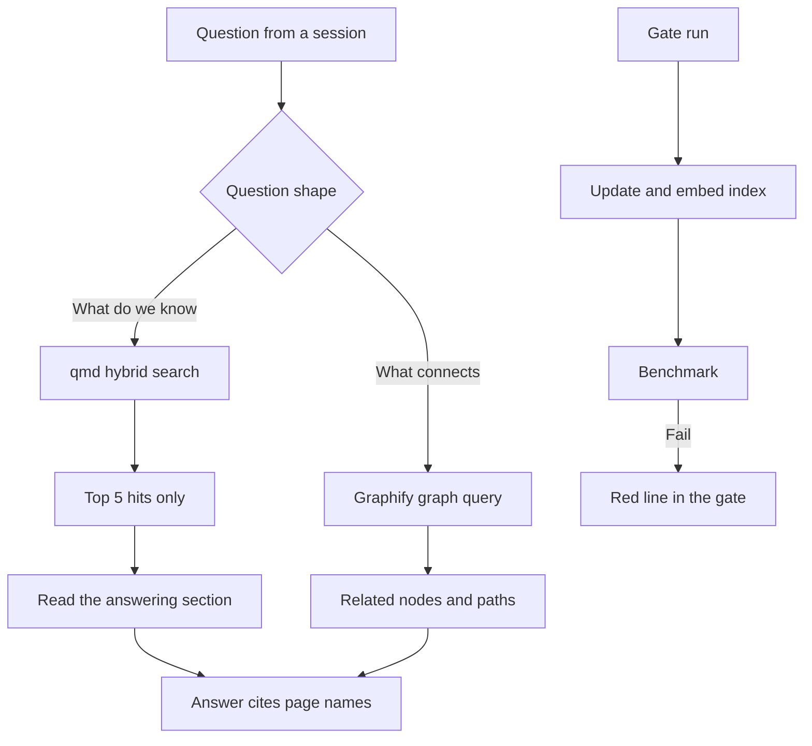

# Search over my own notes, and the benchmark that keeps it honest

> A local, offline search and knowledge-graph layer over my markdown notes, guarded by a standing benchmark. A silent decay was found by measuring the top results by hand, and after the fix the benchmark went from FAIL to PASS on the failing question: from wrong to right, 6585 to 2617 tokens and 15.4s to 0.9s.

## The problem

I keep my projects, decisions and research in one markdown vault, and every Claude Code session works from it. Without a search layer, a session either re-reads whole folders, which is slow and expensive, or it guesses.

On 2026-08-02 retrieval "felt like it was degrading". When I measured it, it looked healthy while returning the wrong pages. A page of one-line summaries matches every topic, so it outranks the page that actually holds the answer. I call these pages decoys. The worst part was that a decoy hit looks like a confident answer.

## What runs

1. **One vault, three indexes.** qmd indexes the vault for search. Graphify builds two knowledge graphs: one over the vault and one over my Claude Code setup (skills, agents, rules and curated memory).
2. **Search runs on the machine.** qmd combines keyword search, vector search and a reranker, with three local models: an embedding model (embeddinggemma-300M-Q8_0, 318 MB), a reranker (qwen3-reranker-0.6b-q8_0, 610 MB) and a query-expansion model (qmd-query-expansion-1.7B-q4_k_m, 1.2 GB), about 2.1 GB in total. Nothing leaves the machine.
3. **A recall skill picks the path by question shape.** "What do we know about X" goes to qmd. "What connects to X" or "trace the flow" goes to the graph. If both are down, the session reads the vault's index page and the top pages.
4. **Results are capped.** Every query asks for 5 results, because the default of 20 costs about 10x the tokens. Each hit carries its line number, so the session reads only the answering section, not the whole page.
5. **Hits are read by kind.** A brief or living page is current truth. A dated progress record is a dated fact and is not called stale for being dated. Old snapshots and rotated log months sit in a separate history collection that is never searched by default, because a snapshot would outrank the current brief.
6. **The gate keeps it fresh.** The end-of-session gate updates and re-embeds the index, then runs the benchmark. There is no daemon.
7. **The graphs are refreshed weekly** by a scheduled job, described in [An unattended weekly job with guards](04-weekly-graph-refresh.md).

## What I measured

| Measure | Value | Date |
|---|---|---|
| Benchmark on the failing question | FAIL to PASS | 2026-08-02 |
| Tokens for that question | 6585 to 2617 | 2026-08-02 |
| Time for that question | 15.4s to 0.9s | 2026-08-02 |
| Saving against reading files | 4.7x to 11.9x | 2026-08-02 |
| Noise in the index before the fix | 18 of 53 indexed rows, about 114 KB, 30% of indexed bytes | 2026-08-02 |
| Index after the first fix | 39 to 36 active docs, 391 to 280 KB, non-content share 34% to 10% | 2026-08-02 |
| Real questions with the wrong rank-1 page after the first fix | 4 of 8 | 2026-08-02 |
| Days the benchmark sat red with nobody aware | 18 (red since 2026-08-26 23:38, found 2026-09-14) | 2026-09-14 |
| Offline replay of qmd's final order | 30 of 30 rows reproduced exactly | 2026-11-02 |

## What broke, and what I changed

**1. The activity log became the top hit for almost everything.** The vault has an append-only log of every filing. On 2026-08-02 it was 105 KB with 74 entries, and it was the rank-1 hit on most topic queries; on one project-status query it took the top slot at 93%. It grew fastest when the system was used well (8 entries that day alone), so every good session made the next search worse. I excluded the log, inbox drops and generated graph reports. After the fix, the curated project page took the top slot on the same query at 93%, and the benchmark went from FAIL to PASS. My first attempt wrote the exclusions straight into qmd's database and silently did nothing: the command line rewrites that column from the YAML config on every call. The YAML is now the source of truth.

**2. A cold-start audit found the fix incomplete.** I had a fresh session, one that made none of the changes, verify the work. On eight real questions, four returned the wrong rank-1 page: the vault's page index (0.88) and the schema document (0.93) had taken the log's place by the same mechanism. The old benchmark scored a keyword anywhere in the top three results, so a rank-1 decoy could not fail it. I excluded both files and added rank-1 cases that assert the exact top file. I checked them both ways: they fail against the old config and pass against the new one. The rule now is that any file whose content summarises other pages stays out of the index. The same day I also retracted a claim from my own first write-up: 17 "ghost" documents were not polluting results (`qmd doctor` showed 39 active docs against 53 rows).

**3. The benchmark's own questions became decoys.** Quoting a benchmark question word for word in a page makes that page win its own test. It happened four times in one session, each time on a page about this retrieval work. The literal questions now live only in the benchmark script, and a question gets reworded if its wording turns up in a page.

**4. The benchmark sat red for 18 days because nothing ran it.** It had been failing since 2026-08-26 23:38 and I found out on 2026-09-14. The benchmark was already marginal. A 173-byte orphan page with the same file name as the real page, written by a session that created a new file instead of appending, ate part of that margin. The answering page had fallen to rank 6. Deleting the orphan, after moving its one unique fact into the real page, took the benchmark from FAIL to PASS, with the answering page at rank 5 and a score of 0.43. Two things that did not help are recorded so they are not retried: rewriting the page's opening and relabelling the competing page; the score stayed at 0.430 through both. The benchmark now runs in every gate run, and unique file names across the vault are a hard rule. In the same review I found that the common end-of-session path had refreshed nothing for 17 days, so the refresh moved into the gate.

**5. A suspected dead vector search was a log line.** On 2026-08-03 a session concluded from one warning line that the vector side had fallen back to the CPU, and it installed a 688 MB toolchain that changed nothing. Measurement settled it: GPU use went from 46% idle to 96-99% during a forced embed run, the run used 1.79s of CPU time for 7.4s of wall time across 209 chunks, and a vector-only query ranked the correct line first (score 45%). The warning was cosmetic. That session had redone an investigation the vault already held, which is why I now require one retrieval call before anyone asserts a defect.

**6. A backlog in another project buried an answer at rank 20.** On 2026-11-02 a large backlog of unfolded notes took the first slot in qmd's first-stage ranking for one benchmark row, and the answering page landed at final rank 20. I measured qmd's score blend and found the weights: 0.75 for first-stage ranks 1-3, 0.60 for 4-10 and 0.40 for 11 and below. A page at rank 11-40 with a good rerank score can therefore end above most pages at rank 4-10. Folding the backlog fixed the row (30 of 30 in the replay). I tested three alternative settings offline on a copy of the index, so the live index was never touched; each also scored 30 of 30 against 29 of 30, but one of them dropped a correct answer that had been rescued from rank 13. I left the blend alone.

**7. Most stored vectors belonged to old page versions, so the vector half of search was dead.** On 2026-10-28 I found that 6972 of 7643 stored vectors (91%) belonged to old versions of pages. The vector half of search was therefore dead: search ran on keywords alone, and an old record ranked first for a question about the present. Unlike the warning in item 5, this one was real. The gate now runs a cleanup step that deletes such vectors, and the benchmark gained a guard for the vector half.

## Design choices

- **Two engines that answer different questions.** qmd is cheaper for plain lookups; the graph shows how scattered hits relate. I ruled "which one is better" the wrong question.
- **Exclude summaries, not content.** A file that summarises other pages has the decoy shape. The task list is handled differently in each engine: it stays in the graph, where structure is the point and nothing competes for rank, and stays out of search. I measured first: on the one benchmark question about the task board it ranked only 3rd, so nothing was lost.
- **Assert the rank-1 file, not a keyword.** The keyword check had let a rank-1 decoy pass unnoticed for twelve days.
- **Keep the test text out of the corpus.** Otherwise the benchmark measures itself.
- **Measure tuning offline first.** Changes to ranking were tried on a copied index before anything live was touched.
- **Reads before assertions.** One retrieval call before claiming a defect, and a flagged hit is not triage until someone checks it.

## Limits

- The numbers come from my own vault and my own questions. This is not a public benchmark, and it is a single-user system.
- The benchmark is pass or fail on a handful of real questions, plus the 30-row replay. I have no broader accuracy or recall score.
- Excluding the log exposed three facts that lived only there. That was a filing failure, not a search failure, and it shows that search can only find what was written to a page.
- One question is still open: the same score pattern recurred across different queries, which looks like fixed reranker slots rather than true similarity. I flagged it to understand before tuning anything.
- qmd and Graphify are third-party open-source tools. I configured and wrapped them; I did not build the search or graph engines.

## My part

I noticed the decay, set the pass bar (cheaper than reading the files and correct on every case), chose to measure the top results instead of trusting the feel, and decided each exclusion and each rule above. I asked for the cold-start audit, reviewed its findings, including the ones that corrected my own claims, and decided to leave the score blend alone. Claude Code wrote most of the scripts, the config changes and the notes under my direction, and sessions did the filing.
