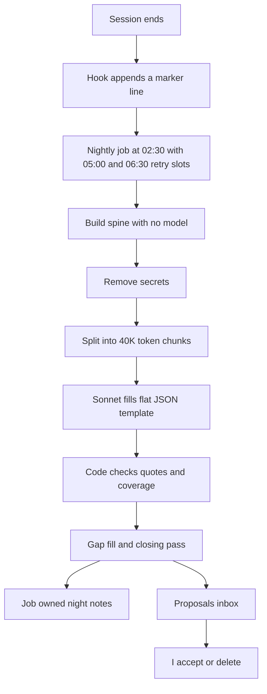

# The night shift: a nightly job that files what my AI sessions learned

> A scheduled job reads the day's AI coding sessions overnight, has Sonnet fill a fixed JSON template, checks every claim against the transcript in code, and files the result into my knowledge base. After a propose-only trial (2026-10-25 to 2026-11-01, five nights), it has been writing live since 2026-11-02.

## The problem

I run many Claude Code sessions in parallel across several projects. Agent OS, my personal knowledge base (the vault), is only useful if each session's decisions, findings and open items get filed. The manual step that did this, a `/wrapup` command, had three problems.

- **I forgot to run it.** With many sessions open at once, sessions that were never wrapped up were lost to the vault.
- **It was expensive.** `/wrapup` runs inside the long session it saves, so every model call re-sends that session's whole context: 250–480K tokens per call on Opus with a 1M context. Across 25 runs in 45 days of transcripts, a small `/wrapup` took 4–10 model calls, 1.0–3.5M cache-read tokens and 0.3–1.7M cache-write tokens, about $2–10 each at list prices, mostly from Opus cache writes. It also drew on the same usage limit as my interactive sessions.
- **End-of-session capture was unreliable.** The SessionEnd hook has a 1.5–60 s budget but my first version started a 150 s model call from it. Desktop sessions stay open for days and are killed about 2 s after archive. No log recorded what had been captured.

The lesson that shaped the design: where a run happens matters more than which model it uses. A fresh nightly run per session costs a half to a tenth of one in-session `/wrapup`, even on Opus.

## What runs

1. **Hooks only mark.** A SessionEnd hook appends one line (session id, transcript path, folder, time) to a queue file under `~/.local/state/agent-os/`. No model call, under 100 ms.
2. **One scheduled run.** A launchd job (`com.example.agent-os-night`) fires at 02:30. A second slot at 05:00 runs only if no successful run is stamped for today. A third slot at 06:30 was added on 2026-11-01. An abort or a held lock writes no stamp, so the retry runs. It shares a lock with my other vault jobs and is idempotent.
3. **Select sessions.** Transcripts that changed since the last stored byte offset, keyed by file path because two files can share a session id. Automation runs and subagent sidechains are skipped. Sessions still open are ingested as deltas from the stored offset.
4. **Build the spine with no model.** Keep every user message and every assistant text block in full with its turn number, compaction summaries, one line per tool call, short tool results and tool errors. Drop only system reminders and long tool output. Secrets are removed by regex before anything leaves the machine, and the spine is stored outside the vault and outside git.
5. **Chunk only when needed.** A spine over 40K tokens is split at turn boundaries, never inside a turn. Later chunks, and later nights, receive the items already extracted so a reversed decision supersedes the earlier one.
6. **Add vault context at no model cost.** The project's current brief (cut to its status and open questions), its night-notes items from the last 30 days so duplicates get marked, and the titles of the top qmd search hits as candidate targets.
7. **One trimmed headless call per chunk.** `claude -p` on Sonnet at low effort with no tools, no MCP servers, no CLAUDE.md, no hooks, no session persistence, prompt caching off, a fixed system prompt and a JSON schema. The API key is unset so it runs on the plan, not API billing. A usage-limit error stops the run and keeps the queue for the next slot.
8. **A flat JSON schema.** A session summary of at most 250 words, plus items with a kind (decision, finding, fact, correction, task, open item, artifact, question), text, a free-text `why`, a verbatim quote of up to 200 characters, a turn number, a status, importance and targets. The free-text `why` is there because strict formats can hurt a model's reasoning.
9. **Code validates every item.** The quote must appear in the spine after whitespace normalisation and be at least 15 characters long. An item without a matching quote is never written as fact; it goes to proposals marked unverified. A hash of kind plus text removes duplicates across chunks and nights. An artifact must name a path, URL, page or commit that the spine also contains. Code never marks a standing decision as reversed; a replacement becomes a pair for review.
10. **Coverage check, gap-fill and closing pass.** Every user turn of more than about 40 characters must be cited by an item or listed as having no durable content. Uncovered turns go to one more call. A closing pass then sees the chunk summaries, all items and the last 15K tokens, and returns only tasks and open items that pass the same checks. Coverage is logged every night, so a skipped session shows up as a number.
11. **Write only what the job owns.** Each project gets one job-owned page, `$VAULT/projects/<slug>/wiki/<slug>-night-notes.md`, with a dated section per session and a block id per item so re-runs never duplicate. Anything that touches shared state (tasks, memories, brief changes, replacements, unfiled items) goes to `$VAULT/inbox/proposed/<date>.md`.
12. **Commit only the job's lines.** Shared files are committed as their last committed version with the job's insertions replayed through a private git index, so other sessions' uncommitted work is never swept in. The job refuses to commit if anything else is staged.
13. **Human review with no model.** A morning notification gives the session, project and proposal counts. `night_shift.py --accept` applies the proposals I ticked; rejecting one means deleting it. A memory flagged as a possible duplicate adds one "confirmed again" line to the older memory instead of a new file.

The same pipeline also reads sessions from a second AI coding tool, Antigravity, with the same spine, redaction, quote check and coverage check. A weekly job (`com.example.agent-os-weekly`, capped at $2.00 a week) folds night notes into each project brief as proposals, which apply only if the page is unchanged since the proposal was written.

## What I measured

All numbers are self-measured on my own sessions. Costs are list-price estimates.

| Measure | Value | Date |
|---|---|---|
| Headless call overhead: default, with only `--tools ""`, full trim | 42.7K, 168K, 1.4K tokens | 2026-10-24 |
| Spine size against raw transcript bytes | 1.5% | 2026-10-24 |
| Conversation text the old 60K-character cap dropped on the 4 biggest sessions | 92%, 84%, 71%, 68% | 2026-10-24 |
| Small session cost cut by turning prompt caching off | 41% ($0.066 to $0.039) | 2026-10-24 |
| Biggest session of the week: coverage before and after gap-fill | 17.9% to 100% (5 of 28 user messages cited at first) | 2026-10-24 |
| Unfiled items after the first quality-fix round, 3 sessions | 10 to 0 | 2026-10-24 |
| Gold set after the fragment fix | 82 items, 70 reachable from the spine | 2026-10-25 |
| Items in the first gold set whose words exist only outside the spine | about 13% | 2026-10 |
| Real Sonnet cost per million spine tokens (assumed $2.6) | about $4.4 | 2026-10 |
| Weekly cost estimate after that correction | about $5–6 | 2026-10 |
| Cost per session, 10 logged sessions | average $0.23, median $0.15, highest $0.61 | 2026-10 |
| Substantive sessions in the last 14 days | 52, about 4 a day, about $1.07 a night with the closing pass | 2026-10 |
| Transcripts from before 2026-10-24 marked as already captured | 203 | 2026-10 |

**The evaluation.** The gold set came from five sessions that had a manual `/wrapup` written by Opus with full context. The model under test saw each session only up to the entry before the wrap-up request, and one Sonnet judge call scored every model the same way. Recall is reported on "reachable" gold, meaning items whose words exist in the spine.

**Model comparison** (bake-off v4, the same 5 sessions, Opus at low effort, all runs re-judged after the gold-set fix):

| | Sonnet 80K chunks | Sonnet 40K chunks | Haiku 80K chunks | Opus 40K chunks |
|---|---|---|---|---|
| Recall, 70 reachable items | 61.4% (43) | **70.0% (49)** | 68.6% (48) | 68.6% (48) |
| Recall, all 82 items | 56.1% | **65.9%** | 62.2% | 64.6% |
| Recall, decisions and tasks (reachable) | 66.7% | **70.0%** | 56.7% | 70.0% |
| Items extracted | 139 | 180 | 465 | 217 |
| Judged not supported | 18% | 7.8% | 4.3% | 6.0% |
| Extraction cost | $1.55 | $1.60 | $0.51 | $2.93 |

Chunk size, not the model, caused Sonnet's earlier under-extraction. Opus found 48 reachable items against Sonnet's 49 at 1.8x the price; together they reach 74.3%. I had set the rule beforehand that Opus must win by 5 points or more to justify a weekly Opus second opinion (about $7 a week), so I did not build it.

**Effort** (bake-off v5, the 2 sessions holding 10 of the 14 items every v4 run missed): Opus at xhigh wrote 232 items against 68 at low, cost $2.53 against $0.71, and found 0 of those 10 items. Sonnet at high cost $0.56 against $0.44 at low and also found 0. Thinking is billed as output, so the job always runs at low effort.

**Closing pass.** Sonnet at 40K missed 28 of 82 gold items, and 19 of those were end-of-session to-dos: a single chunk cannot know something stayed open until the end. Recall by kind was decisions 15/18 (83%), facts 15/19 (79%), open items 9/18 (50%), tasks 7/17 (41%). A closing pass with a second prompt version lifted to-do recall from 16 of 35 (46%) to 19 of 35 (54%) for about $0.06 a session; 18 of the 20 items it added were real to-dos. I turned it on 2026-10-25.

**Rollout.** The launchd job was loaded on 2026-10-25 in propose-only mode. The trial ran for 5 nights, 22 sessions and 454 items, wrote previews to a state folder and filed nothing in the vault while the evaluation and the bar were settled. I made the switch to live mode on 2026-11-01 and the first live night was 2026-11-02 at 02:30. It has run live with `--nightly --apply --gate` since 2026-11-02, inside a nightly cap of $1.50 at list prices. Every chunk's cost counts against the cap, and a session whose estimated cost cannot fit is deferred before it starts, unless it is the night's first. Leftover sessions wait for the next night.

## What broke, and what I changed

- **The first draft skipped content.** It gave Haiku a capped excerpt of each session (20K characters from the start, 40K from the end). My review on 2026-10-24 ruled that skipping conversation content downgrades the whole system. I redesigned the input around the full spine and moved from Haiku to Sonnet.
- **The cost model was wrong twice.** Token counts were 1.55x too low because the first estimate assumed 3.6 characters per token; measuring 5 real calls showed 2.15–2.42, so the constant became 2.3. Separately, Claude Code was writing a one-hour prompt cache on every call that was never read, at 2x the input price. Turning caching off cut the small session's cost by 41%.
- **A headline result was an artifact.** Bake-off v2 reported 76.0% reachable recall. Judging the Opus run exposed the cause: 93 of the 193 gold items were line fragments of wrapped bullets. After the fix the gold became 82 items, all runs were re-judged ($1.00), and the Sonnet setup fell to 70.0%.
- **The model invented a quote.** In an early run one item quoted a sentence claiming a task was finished that appears nowhere in the session. The code quote check held it as unverified instead of filing it as fact. A later run let a one-character quote through, so quotes now need at least 15 characters.
- **Long sessions were under-covered.** The first call on the biggest session cited only 5 of its 28 substantive user messages. One gap-fill call of 13.5K tokens brought coverage to 100%, and coverage is now logged nightly.
- **The first two scheduled nights died.** Both the 2026-10-25 and 2026-10-26 runs stopped on a usage limit that interactive sessions had already used up. I added the 05:00 retry slot with a success stamp on 2026-10-26 and tested the wrapper in 7 cases.

## Design choices

- **Capture moved out of the session.** A hook cannot hold a model call, and an in-session call re-sends the whole context. Hooks write one line; the model work happens once, at night, on a fresh small context.
- **No content is skipped.** The spine keeps every user and assistant word because the old cap dropped up to 92% of the biggest sessions. It is still only 1.5% of raw bytes.
- **The model fills fields; code writes files.** A cheap model fills a flat template and deterministic code appends or patches. Whole-file rewrites by a model are slow and costly.
- **Every claim carries a quote that code checks.** Model output is not treated as fact until its quote is found in the transcript.
- **The job owns some files and proposes the rest.** Briefs, tasks and memories are edited by live sessions, so the job never edits them in place. The human accept step is deliberate.
- **Trimmed headless calls.** The full flag set cut overhead from 42.7K tokens to 1.4K, and leaving the API key unset keeps the job on the plan.
- **Model choice is a price question.** The first design assumed usage limits were counted per model family. They are not: there is one window for all models, so the choice came down to price and the bake-off.
- **Decisions never expire.** Night notes keep every dated decision; only proposals get merged, and folded items move to a history folder instead of being deleted.
- **A fallback stays in place.** How headless calls count against a plan is the vendor's policy and can change, so the model-free parts and a manual `/wrapup` remain usable.
- **Things I chose not to use:** batch API and prompt caching (they need separate API billing), hosted memory frameworks (they need servers or a graph database), cloud routines (no access to a local vault) and desktop scheduled tasks (each runs a full session).

## Limits

- This is a single-user system, and every number above is self-measured on my own sessions.
- The gold set is itself a model's summary (Opus wrap-ups), not ground truth, and it covers only five sessions.
- The bar has had three settings, all mine: 90% or more on decisions, corrections and tasks (2026-10-24), then 75% reachable recall, then about 70% reachable recall (both 2026-10-25), always with under 10% judged unsupported and a hand spot-check. No run passed the first bar, and the chosen setup sits exactly on the last one at 70.0%. Two things limit the risk: code checks every filed quote, and memories and high-importance tasks stay propose-only (see [06](06-evaluating-my-own-system.md)).
- The judge is noisy: the same 32 items were judged 0 unsupported in one round and 13 in the next. A hand spot-check of the 14 items flagged for the chosen setup found none invented, mostly compound items whose quote supported only one part.
- To-do recall is 54% even with the closing pass. The routine-task filter also dropped one real to-do because it cannot tell housekeeping from a task about housekeeping.
- One chunk used 171K input tokens in one run and 85K in another, and I did not find the cause. Per-call turn counts are now logged so a hidden retry would show.

## My part

I set the goal, the constraint that no conversation content may be skipped, the pass bars and the rule that Opus had to win by 5 points. I chose the model, chunk size and effort from the bake-offs, decided what the job may write and what must come to me as a proposal, and approved the trial and the switch to live. My review of the first draft is what forced the no-skip redesign, and the accept step for proposals is mine. Claude Code wrote most of the code and most of the design notes under my direction. Claude Code, qmd, Obsidian and launchd are dependencies I configured, not my own work.
