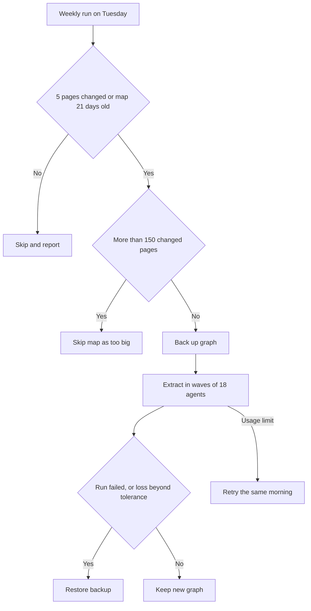

# An unattended weekly job with guards

> A scheduled job that refreshes two knowledge graphs of my notes every week without me, and restores a backup when a refresh fails or loses nodes. Its extraction rules come from measured failures, such as a refresh that cut the vault graph from 1082 to 891 nodes.

## The problem

I keep two Graphify knowledge graphs: one over my markdown vault and one over my Claude Code setup. Sessions query them for "what connects to X" questions (see [Search over my own notes](02-retrieval-and-benchmark.md)). A graph is only useful if it matches the notes, and refreshing it costs model tokens, because agents read each changed page and extract its entities and links.

My first policy was to refresh on request only. It failed: both graphs went 12 days stale because nobody asked. By 2026-08-02 the vault graph, built on 2026-07-21, was behind on 24 changed pages, nearly half the vault at the time. A rule that is never triggered is not a policy.

The opposite, refreshing at the end of every session, would pay extraction cost for nothing, since most sessions touch one to three pages. A refresh can also do harm: Graphify replaces every re-extracted file's nodes before it merges, so an agent that skims a page deletes richer nodes that an earlier run captured.

## What runs

1. **Schedule.** Since 2026-10-25 a launchd job runs the refresh headless every Tuesday at 03:30. A 06:00 retry was added on 2026-10-27, after the first 03:30 run stopped on the weekly usage limit; it runs when the 03:30 run stopped on the limit or never ran.
2. **Trigger.** A map is refreshed only when 5 or more of its pages changed or it is 21 days old. Otherwise the job skips it.
3. **Size and cost caps.** If more than 150 pages changed, the job skips that map as too big rather than run an expensive refresh unattended; the limit was 60 until 2026-11-02. The cost caps are $10 for the setup map and $50 for the vault map, as list-price estimates; the vault cap was $25 until 2026-11-02.
4. **Backup.** The job backs up each graph before it runs. The job also commits each graph's tracked graph files to git (one repo for the vault, one for the setup folder), because the update runbook deletes its own rollback on success.
5. **Extraction.** Agents extract changed pages under the rules in the next section, in waves of at most 18.
6. **Shrink guard.** The job restores the backup if the run fails, if nodes fall more than 2% (edges 5%) beyond what deleted pages owned, or if a re-extracted page keeps under half its old node density.
7. **Forecast and report.** The end-of-session gate and a session-start nudge print a line for each graph. Since 2026-11-02 the gate's line prints the job's own decision, so I can see before Tuesday if it will skip a map as too big, and afterwards if it was not loaded, missed a run, restored a backup or failed.

## What I measured

| Measure | Value | Date |
|---|---|---|
| Vault graph refresh after the stale period | 115 to 367 nodes, 191 to 521 edges | 2026-08-02 |
| Cost of that refresh | 612,575 input tokens, about 232k of them lost to a session-limit failure that wrote nothing | 2026-08-02 |
| Setup graph refresh | 97 to 136 nodes, 134 to 165 links | 2026-08-03 |
| 11 files on one agent | 121 nodes; vault went 1082 to 891 | 2026-09-14 |
| About 2 files per agent | 418 nodes; vault went 967 to 1234 | 2026-09-14 |
| One 25 KB page | 23 nodes when sharing an agent with ten others, 161 with an agent to itself | 2026-09-14 |
| Refresh at 1 to 3 files per agent, before the coverage rule | 2676 to 2440 nodes | 2026-10-04 |
| Same refresh after the coverage rule | 3773 nodes | 2026-10-04 |
| 122-page manual refresh in waves | 11901 to 13775 nodes | 2026-11-02 |
| 43-page vault run | 10.5 minutes, $11.23 at list price against a $14.27 estimate | 2026-10-27 |
| Vault run over 15 stale pages | Estimated at $5.46, cost $7.09 at list price, took 16.8 minutes; 13775 to 14775 nodes | 2026-11-03 |

## What broke, and what I changed

**1. A refresh shrank the graph.** Graphify's skill said to give 20 to 25 files to each extraction agent. On 2026-09-14, 11 files on one agent produced 121 nodes and took the vault from 1082 to 891 nodes, while about 2 files per agent produced 418 and took it from 967 to 1234. One 25 KB page gave 23 nodes when it shared an agent with ten others and 161 with an agent to itself. I changed the rule to chunk by density, not by file count: 1 to 3 prose files per agent, a dense page (over about 15 KB) alone, and 20 to 25 only for thin, uniform files.

**2. Agents still summarised with one file each.** On 2026-10-04 a refresh at 1 to 3 files per agent still took the vault from 2676 to 2440 nodes; one page went from 161 to 65 nodes and another from 74 to 22. I added a coverage rule to every prompt: every named entity gets its own node, and no list is folded into one node. Each prompt also carries the page's previous node count, and counts are compared per page before anything is written. The seven pages were re-run and all came back above their old count (161 to 334, 147 to 368, 87 to 273), and the graph went to 3773 nodes.

**3. Too many agents at once.** On 2026-11-02 I ran a 122-page refresh by hand and sent 60 agent calls in one message. At most 20 subagents run at once, so 40 of the calls failed with a concurrency-limit error and their chunks were dropped. Now agents go out in waves of at most 18, one wave per message, and each wave finishes before the next starts. Sent that way, the refresh took the vault from 11901 to 13775 nodes. The same run showed that a size hint in a prompt reads as a cap: "one Write call holds about 100 nodes" made agents stop near 100. Prompts now say there is no node limit, and dense pages (an old count over about 140) are cut into line-range sections.

**4. A stray second install ran the job.** The skill's install step read the whole first line of the tool's launcher, rejected it because of a space before a flag, and fell back to the system Python, where it installed a second, newer copy of Graphify (0.9.22 beside 0.9.21) on 2026-07-21. That copy became the vault map's engine, so the weekly job ran on it. I found it and removed it on 2026-11-02. Both maps now name the one intended interpreter, and the install step keeps only the first word of that line.

**5. The setup graph pulled in files it should not see.** The build scope depended on how the build was invoked, so a headless refresh would have swept in 178 MB of vendored plugin code and 132 MB of session transcripts and other files that must never leave the machine. An ignore file at the root of the setup folder now sets the scope. I extended it on 2026-09-25 after 146 vendor files (font licences, package internals) turned up in the graph.

**6. The documented refresh command was wrong for 12 days.** One wrong form is not a real flag; another is a code-only command that skips markdown and still reports success. The wrong command had spread to 7 documents and 2 memory files, and the first correction pass missed the recall skill itself; a cold-start check caught it. The correct and both wrong forms are now written down side by side.

## Design choices

- **A cheap count before an expensive run.** Counting changed pages costs nothing; extraction costs tokens. The threshold decides whether to spend.
- **Skip loudly, not silently.** A map over the size cap is skipped and the gate says so before the run, so a skip is a visible decision, not a quiet gap.
- **Restore rather than trust.** A failed run, a node loss over 2% (edges 5%) beyond what deleted pages owned, or a re-extracted page under half its old node density is treated as damage, because the merge deletes what a skimming agent missed.
- **Pin the rules outside the installed skill.** Graphify's skill is third-party, and a reinstall reverts my edits. The rules live in my global Claude Code instructions as well, the job's prompt restates the wave rule, and the gate fails if the skill loses its chunking rule, its launcher-parsing comment or its wave limit.
- **Rules from measurements, not guesses.** Each extraction rule above comes with the node counts that forced it.

## Limits

- This is a single-user system on my own notes. The node counts are self-measured, and a larger graph is not proof of a better one; the guards catch shrinkage, not wrong links.
- The node counts in the table come from different runs and dates. They show what each rule changed, not a single growth curve.
- The 2026-11-02 run that used waves was manual. The job prompt has carried the wave rule since 2026-11-10, and I have no measured unattended run under it in these notes.
- Graphify, Claude Code and launchd are third-party tools that I configured. I did not write the extraction engine.

## My part

I decided to replace "on request" with a schedule, chose the trigger, the size cap, the backup and the shrink guard, and set the rule that a graph that loses more than the tolerance is a failure. I read the node counts after each bad run, decided each extraction rule, and asked for the gate checks that keep them from being reverted. Claude Code wrote the job, the gate checks and these notes under my direction, and subagents did the extraction.
