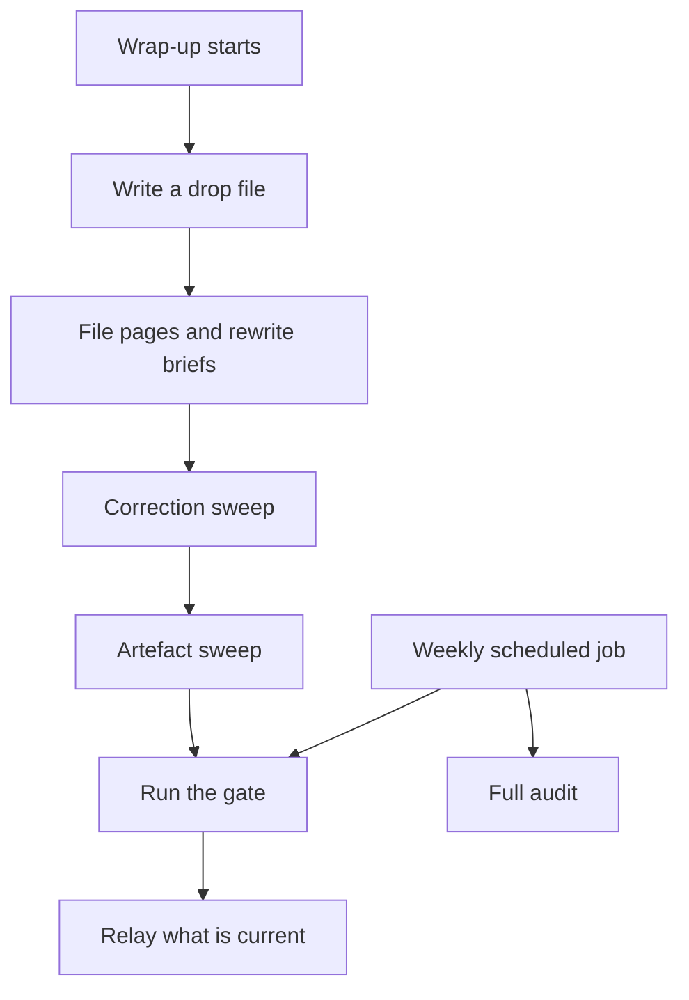

# A gate that fails loud, and an audit that checks the docs against the disk

> A no-model gate runs at the end of every wrap-up and after each nightly filing run, and a weekly audit checks each documented claim about my AI memory system (Agent OS) against the files on disk; on 2026-09-14 the audit checked 41 claims in about 30 seconds and 39 passed.

## The problem

Agent OS is my personal second brain: a markdown vault, local search (qmd), knowledge graphs (Graphify) and the Claude Code skills, hooks and scheduled jobs that read from it and write to it. It is a single-user system, and I am the only reader besides the Claude sessions that query it first.

It rotted quietly. Three audits found that every defect had the same shape: a rule that was correct in the documentation and not true in practice. I call this failure class "documented but unexecuted". Hand-typed numbers went stale. The search index and the graphs fell behind the pages. A correction made in one place survived in another. Pages that described how a system worked went stale when the system changed under them, with nothing corrected anywhere.

I needed cheap, repeatable proof that the knowledge base was healthy, and a session-end routine that did not burn tokens to produce it.

## What runs

1. **Drop.** The session writes a short drop file to the vault inbox: what happened, decisions, open follow-ups, candidate tasks and the files it already updated. After a long session whose context was compressed, the drop is rebuilt from git log, commit bodies, ledgers and the plan, not from memory.
2. **File.** If the session already filed its own changes, the wrap-up does the mechanical steps itself with no subagent. It appends to the log without reading it, edits one index line by searching for it first, and rewrites each project brief in place whose current truth changed.
3. **Correction sweep.** One regular expression per claim the session corrected, run across the vault, the agent memory folder and any other repo roots. Each hit is sorted by whether correction language ("previously", "superseded", "no longer") sits within five lines of it. It prints candidates and never edits.
4. **Artefact sweep.** It lists every code file changed in my local git repos in the window, then flags vault pages whose `updated:` date is older than the newest change to a file the page names. The session must update each flagged page or consciously leave it, and say which.
5. **Gate.** A shell script with no model calls. It prints one `OK` or `FAIL` line per step and exits non-zero on any failure. It runs on both wrap-up paths, even when nothing was filed.
6. **Relay.** The session reports what was filed, what the sweeps caught and the gate result, and names which layers are current. Search is fresh after every gate; the graph map is fresh only when the gate says so.

The gate steps, in order:

- **Search:** `qmd update`, `qmd cleanup` (drops vectors of old page versions), `qmd embed`, run a second time if anything is still pending.
- **Facts:** a script regenerates a block of volatile facts (graph shape, corpus size, tool versions) between markers on one page. It runs after the re-index because it records the corpus size.
- **Map freshness:** for each of two Graphify graphs, the gate counts files newer than the graph. A stale map prints a `STALE` line with the weekly refresh job's state and the job's own forecast, including "too big" when the job will skip it. A stale map is never a failure and never silent.
- **Brief check and lint:** report only. The brief check fails the gate only if its own script crashes.
- **Retrieval benchmark:** a fixed set of questions with the page that must come back for each; every failing row is printed.
- **Backup:** if the vault has a remote, the gate commits only the one facts file it just rewrote, pushes, and fails on a failed push or a missing upstream. It notes how many other files are not backed up.
- **Heartbeat:** a stamp with the time and `OK` or `FAIL`, written on both outcomes. A session-start nudge reads it.

The **weekly scheduled job** (a launchd job, `com.example.agent-os-gate`) sets an explicit PATH, runs the gate, then runs the full audit and keeps the last 400 lines of their output. It writes a second stamp that only this job writes, so a week of manual runs cannot hide a dead scheduled job. It always exits 0, so a red gate is never recorded as a crashed job.

The **audit** is read-only and makes no model calls. It asserts claims, not code style: scripts are present and pass their self-checks; hooks are wired; the gate has every step and fails loud; the staleness watcher covers every tree the graph draws from; the live qmd and Graphify versions match every page that states one; the unattended jobs are loaded and fired recently; every page is in the index and every wiki link resolves; generated fact blocks are fresh; every project brief is current. It exits 1 on any failure.

## What I measured

All numbers are self-measured on my own vault and setup.

| Measure | Value | Date |
|---|---|---|
| Token cost of two wrap-ups before the cost rules | about 187k tokens | 2026-08-02 |
| Deferred items in a build ledger vs in the drop written from compressed context | 24 vs 3 (about 88% lost) | 2026-08-18 |
| Days the retrieval benchmark went unrun while wrap-ups reported success | 18 | 2026-08-26 to 2026-09-13 |
| Graph nodes the staleness watcher could not see | 91 of 967 | 2026-09-14 |
| Defects in the second audit that were one hand-typed number gone stale | 6 of 11 | 2026-09-14 |
| Documented claims the audit checked, and how many passed | 41 checked, 39 passed | 2026-09-14 |
| Audit runtime | about 30 seconds | 2026-09-14 |
| Share of the search index that was dead vectors | 91% (6972 of 7643) | 2026-10-28 |
| Graph map lag while the viewer rebuild printed OK | 9 days, 14 files | 2026-10-04 |
| Changed pages vs the refresh job's limit | 122 vs 60 | 2026-11-02 |

The two failing checks on 2026-09-14 were uncommitted work, cleared by committing.

## What broke, and what I changed

**A job nobody watched.** A scheduled job in another project died and stayed dead for 16 days because nothing watched the watcher. A shared stamp could not tell "the weekly job fired" from "someone ran the gate by hand". I added the heartbeat on both outcomes and the separate stamp only the scheduled job writes. The session-start nudge has three tested branches: has not run in 14 days, last ran red, never recorded a run. A week where the scheduled job dies is now caught within ten days.

**The benchmark ran only on one path.** A page said the filing agent ran the benchmark after every filing pass. That was true of the agent and false of the system, because the wrap-up skips the agent when the session filed its own changes. The benchmark went 18 days unrun while wrap-ups reported success. The gate now runs on both paths and writes the heartbeat.

**The gate was red by its own construction.** The facts step ran before the re-index, so the page carried the old corpus size (961 vectors on the page, 974 on disk) and its own check failed after every run. The end-to-end audit found it on 2026-09-14. I moved the step after the re-index.

**Dead vectors filled the index.** `qmd update` never deletes the vectors of an edited page's old version. By 2026-10-28 they were 91% of the index, the vector half of search returned nothing, and queries ran on keywords alone. I added `qmd cleanup` to the gate.

**Two green lines that meant nothing.** On 2026-10-04 both graph-viewer steps printed OK while the vault map was 9 days and 14 files behind; my review caught it. The gate now prints a map line on every run. On 2026-11-02 that line still said the weekly job would refresh a stale map, while the job skips any map with more changed pages than its limit (122 against 60 that day). The gate now prints the job's own forecast and keeps no copy of the limit. Separately, a code review on 2026-11-01 found that a crashing brief check printed "OK" and a missing upstream read as "nothing to push". Exit codes now decide both.

**A wrap-up that lost most of its findings.** On 2026-08-18 a 12-task build's ledger held 24 deferred items; the drop written from compressed context carried 3. Four of five spot-checked findings existed nowhere but the ledger, and the drop looked complete. The rule now is to rebuild the drop from the written record first.

## Design choices

- **Do not write down a fact a script can read.** Six of eleven defects in the second audit were the same defect: a hand-typed number that later stopped being true. One page said the graph held 367 nodes when it held 967. Two pages written the same morning quoted 1082 nodes and were stale within the hour. Volatile facts now live in one generated block that other pages link to. Facts that change by the hour stay in the session-start status script and are never written to a page.
- **An automation ladder.** I rank each rule by how it is carried out: manual, documented, nudge, gate, scheduled, self-checking. "Documented" is the trap rung, because it reads like done. Most fixes on this page move a rule off that rung to a nudge, a gate or a scheduled job.
- **Two sweeps, not one.** A regex sweep cannot find a page that went stale because the system moved under it. On 2026-09-21 the correction sweep passed clean while an operations page in another project described one scheduled job when there were two. The artefact sweep exists for that case. Both sweeps print and never edit, because many mentions are legitimate history.
- **Report the map, do not refresh it in the gate.** A graph refresh cost 612K tokens for a 45-file corpus on 2026-08-02. The gate reports; a weekly job refreshes (since 2026-10-25); a map the job will skip is named as my step.
- **A false red is worse than no benchmark.** It teaches the reader to discount the real ones. The gate settles the index before grading, and the benchmark warns when the index is unsettled but still grades and still fails.
- **Lint never blocks filing.** A lint that blocks filing gets switched off.
- **Commit one file only.** The gate commits only the file it regenerated, so it never sweeps up another session's staged work.
- **Guards with a reset.** Graph community labels carry a fingerprint of the membership they were written for, because cluster ids are not stable between runs. A re-cluster had moved every label onto the wrong cluster; I had all 103 vault and 46 setup labels re-read and rewritten. A `--restamp` reset exists, because a guard with no reset is a guard someone eventually deletes.
- **Compare versions to the live binary.** The audit reads each version a page states and compares it with the installed tool, instead of hard-coding versions that go red on every upgrade.
- **Cost rules for the wrap-up.** Never read the append-only log (123.7 KB and 81 entries on 2026-08-03; reading it costs about 30k tokens). Search for the anchor, then edit one line. Skip the subagent when the session already filed its changes, because it would spend 80-100k tokens rediscovering edits the session can already see.

## Limits

- This is a single-user system and every number above is self-measured on my own data.
- The gate proves the index, the benchmark and the backup are healthy at the moment it runs. It does not prove the pages are correct; it proves a fixed list of claims hold.
- The audit only checks claims someone thought to write a check for. A new rule is "documented" until a check exists.
- The sweeps print candidates. A person or a session still has to judge each one.
- The weekly cadence means a dead scheduled job can go up to ten days before the nudge catches it.

## My part

I set the goals, the pass bars and the checks: what the gate must fail on, what may only report, which claims the audit asserts and when a stale map is my step rather than the job's. I directed the audits, read the findings, caught the stale-map false green myself and decided each fix. Claude Code wrote most of the scripts and the page text under my direction. qmd, Graphify, launchd and Claude Code are third-party tools I configured, not my own work.
