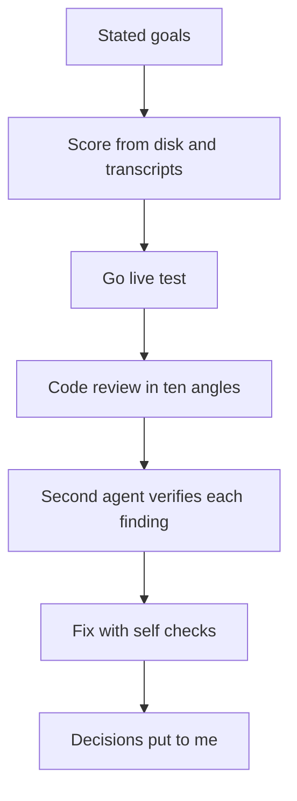

# Auditing my own AI memory system

> On 2026-11-01 I scored my AI memory system (Agent OS) against its own stated goals, tested what an unattended job would do to search before letting it write, and ran a verified ten-angle code review: of its 36 findings, the fix session that day fixed 29, partly fixed 4 and deferred 3.

## The problem

Agent OS files knowledge into a markdown vault, runs nightly and weekly jobs, and pushes the vault to a private remote. A system like that can fail without anyone seeing it: a rule correct in the documentation but not true in practice, a job that exits 0 while doing nothing, a secret that slips into a pushed file, or a wiki where finished records outrank the current truth.

I am its only user. I needed an honest scoreboard against the goals I had written down, a way to find defects before switching a nightly job from proposing changes to writing them, and a rule for what happens to a page when it stops being current.

## What runs

1. **Scoreboard.** I took 11 stated goals, each with its source page and date, and scored each one from disk state, scheduler state files, a scan of the last 7 days of session transcripts, a code review and one experiment. Every goal got a status (for example Met, Half met, Not met, Flat, Not in effect, Superseded) with the evidence number beside it.
2. **Go-live test.** The question was: if the nightly job went live tonight, what would its pages do to retrieval? I copied the trial's night-note previews into the vault, re-indexed, ran the retrieval benchmark and three direct queries, then restored everything with `git checkout` and `rm`. Nothing was committed.
3. **Code review.** The review ran ten finder angles over the scripts and the gate: line by line, removed behaviour, shared state and scheduling, language pitfalls, subprocess and environment, reuse, simplification, efficiency, altitude and conventions. A second agent then verified each candidate, with a reproduction where it was cheap (the real functions run on scratch copies, read-only against the vault). A last sweep looked for gaps the angles missed. Every open defect went into the page so none could be lost; nothing was fixed at review time.
4. **Fix session.** The same day, each fix came with a self-check that asserts the fixed behaviour, plus hook tests for the shell wrappers. Scripts were committed after my yes.
5. **Decisions.** Four decisions came to me with two options each and a recommended pick first, alongside 12 small builds that needed no decision and a list of the steps that were mine.

## What I measured

All numbers are self-measured on my own system and data.

| Measure | Value | Date |
|---|---|---|
| Substantial sessions (at least 10 assistant turns) that queried the vault before deriving | 18 of 33 (55%) | 7 days to 2026-11-01 |
| Earlier count, possibly not like for like; it may include automated sdk-cli sessions, which the 2026-11-01 count excludes (an open check) | 7 of 13 (54%) | 2026-09-14 |
| Memory files written or updated | 15 in 14 days, against 0 in the 24 days before 2026-09-14 | 2026-11-01 |
| Nightly capture trial | 22 sessions, 454 verified items, 100% coverage on every session | 2026-10-27 to 2026-10-31 |
| Nightly capture cost | reported as at most $0.74 a night at list price; the job's own spend estimate was higher on two nights, $1.631 on 2026-10-27 and $1.868 on 2026-10-28 against a $1.50 cap (see the budget-cap item below) | 2026-10-27 to 2026-10-31 |
| Extraction quality on an 82-item gold set (bake-off v4) | 70.0% reachable recall, 7.8% unsupported | measured 2026-10-25, restated 2026-11-01 |
| Retrieval benchmark, graded rank rows | 7 of 7 pass | 2026-10-31 |
| Always-on context loaded on every call | 20.5 KB, about 5-6K tokens, about $11 of cache reads per 14 days at list price | 2026-11-01 |
| Prompt-hook latency (a review candidate claimed 1.25-1.5 s) | 0.105 s median, 0.4 s worst, 100 real prompts | 2026-11-01 |
| Deep questions answered with retrieval vs without | 7-11x cheaper, all answers correct | 2026-07-16 |
| A shallow question answered with retrieval vs without | 0.3x, a loss | 2026-07-16 |

**The flat result.** The headline goal, sessions reading the vault before working things out, looks flat: 55% against 54% on 2026-09-14. The earlier count may include automated (sdk-cli) sessions, which the 2026-11-01 count excludes; this is still an open check, so the two figures may not be like for like. The write-back side did move. The scoreboard also showed that the nightly job, loaded on 2026-10-25 in propose-only mode, had filed nothing since, because my morning review step was not taken on any of the five mornings and nothing noticed. A settings-file change was "Not in effect", because the app's per-session setting overrides the file; it became my step.

**The go-live test.** With the raw notes in the vault (118.7 KB, one page alone four times the size of the project brief), the benchmark failed: a past-work question lost its record from the top 3. For "what does the nightly job do", the notes page ranked first (0.88) and the living page second (0.52). The job's own notes would have become the top answer about its own project. I tested a fix, "fold, then history", on the trial's seven note pages:

| | Raw notes | Folded notes |
|---|---|---|
| Notes size (the trial's seven note pages) | 135 KB | 62 KB |
| Notes page rank for the project question | 1 (0.88) | 4 (0.40) |
| Retrieval benchmark | FAIL | PASS |

**The review funnel**, with the corrected counts from the review page's outcome line:

| Stage | Count |
|---|---|
| Candidates after dedup, each verified | 39 |
| Refuted by measurement | 3 |
| Survived (30 confirmed, 6 plausible) | 36 |
| Most severe, sent to the review tool | 20 |
| Fixed in the fix session the same day | 29 |
| Partly fixed (one of the four was finished later that day) | 4 |
| Deferred (one of the three was fixed later that day) | 3 |

## What broke, and what I changed

**A metric graded by the data it filtered.** Capture coverage read 100% while the system had dropped messages I typed mid-turn: over 14 days, 25 such messages and 0 in the record it built, and 46 of 47 mid-turn hand-backs absent. Coverage counted against the same filtered record, so it could not see the loss. The record builder now keeps queued messages, attachments and subagent results. The lesson I kept: a metric computed from the same filtered data it grades cannot catch the filter's loss.

**Secret redaction with gaps.** I had the real redaction functions probed with 15 secret shapes. The pattern missed environment-variable, JSON, `curl -u` and basic-auth shapes, and watched files were re-copied without the secret check. A scan of 1,040 transcripts found no real leak. The patterns became paired regex and replacement rules with word boundaries, one function became the single gate for text and files, and file formats that cannot be scanned are refused.

**A nightly job nobody watched.** On 2026-11-01 both nightly runs aborted on a usage limit, the wrappers exited 0, the stamps had no reader, and the desktop notification failed because non-ASCII text was escaped into a form AppleScript rejects, with the error swallowed. Five mornings had passed with nothing read. The session-start status now prints night, map and audit lines, the audit checks every job's stamp age, and the retry waits for the parsed reset time. A weekly wrapper had a related fault: it stamped success whenever three phrases were missing from its output, so a traceback or a timeout counted as finished. It now stamps on exit code 0, or on a restored run whose output carries no failure phrase, with hook tests for a traceback, a timeout and a missing command.

**A commit race.** Jobs checked the shared git index and then committed without a pathspec. A held lock could leave a file staged while the job marked the work done, and the next gate commit swept it up and pushed it. This was reproduced in a scratch repo. Jobs now commit from a private index file with a compare-and-swap ref update and save state only after the commit succeeds.

**A budget cap that did not cap.** The nightly cap was checked only between sessions, and failed chunks reported no cost, so paid work went uncounted and was paid for again. Estimated spend was $1.631 on 2026-10-27 and $1.868 on 2026-10-28 against a $1.50 cap. Every chunk's cost now counts, a session that cannot fit is deferred before it starts, and a night where everything failed exits non-zero and stamps nothing.

Other shapes the review found: a tool-version flip under the scheduler because its PATH found a second install first (the recorded tool version flipped 12 times since 2026-09-14, and the audit check failed on all 5 weekly runs whose logs were kept), note headings dated one day off (9 of 25 results), and a routine-item filter that dropped real to-dos (30 items dropped in 25 results, at least 6 real).

## Design choices

**Go live, gated.** I switched the nightly job to writing from 2026-11-02 rather than run another trial week. It met my quality bar exactly on the 82-item gold set: 70.0% reachable recall against about 70%, and 7.8% unsupported against under 10%. I lowered that recall bar from 75% to about 70% on 2026-10-25, after two bake-offs showed that no run reached 75% on the 82-item gold set. So the live nights were the real test: the five trial nights had run clean, and a sixth unread preview would prove nothing. It stays propose-only for memories and high-importance tasks, and it refuses to run without an explicit mode flag, because a hand run could otherwise file the 454 trial items by accident.

**Verify before fixing.** Three candidates were refuted by measurement before any work was spent on them, including the latency claim above.

### The three-layer lifecycle rule

This came from a failure. On 2026-10-26 an automated pass moved 8 finished progress records (audits, results, a fixed-bug write-up, a worked backlog) out of default search because they were "dated and done". I caught it. The underlying idea is that there are two kinds of truth: a state claim is true until it changes, and an event claim ("the audit found a defect") never goes stale. I had three research agents survey practice on decision records, bitemporal history and agent memory, about 40 searches and page reads each, then set three layers:

| Layer | What it holds | Rule |
|---|---|---|
| Current truth | Project briefs and living pages | Corrected in place; ranked first |
| Progress | Audits, results, debriefs, scans, ledgers, incident write-ups, logs, night notes | Never moved; a wrong claim gets a dated correction note |
| History | Only material that was replaced | Needs a successor pointer both ways; searched on request |

The test for history is an explicit successor plus whether the claim is about state or an event, never "dated" or "done". Wrong duplicates are deleted, plans are superseded, records are kept.

**The write-time rule.** An agent with a new fact follows six steps. If it is already present, write nothing. If it is a new finding, add a progress record, then correct the current-truth claim and cite it (always two writes). If the state changed, edit in place and leave a dated line with the old value. If a claim was never true, fix it in place on a living page, or add a dated correction inside a progress record. If a plan was replaced, set its successor first; only then may it move. Before creating a page, search for one with the same scope.

**Enforcement, built 2026-10-26 to 2026-10-28.** Every page declares a kind; I approved the backfill list of 95 pages (living 55, progress 19, plan 10, brief 7, snapshot 3, source 1). The move tool refuses to move progress records and refuses a move without a successor. The benchmark fails if a current-state page does not outrank every progress record, or if a progress record leaves default search. A report-only lint flags undated present-tense lines, living pages unchecked for 90 days and near-duplicate pages at a 0.55 similarity bar. On 2026-10-28 it found 44 undated present-tense lines in 12 progress records and 90 in 37 living pages, 4 living pages unchecked for 90 days or more, and no near-duplicate pairs (the closest legitimate pair scored 0.49).

**No ranking multiplier.** When the benchmark put an August record first for a question about now, it looked like a weighting problem. The real cause was that 91% of the vectors came from old page versions; once the gate dropped them, current pages ranked first again. The benchmark guards the risk more cheaply than a multiplier would.

**Grade records by presence, not rank.** I measured that 11 of the 15 progress records found by a title-based count at that time, before the approved backfill list made it 19, rank first for their own title; the rest lose to a brief that summarises them, which is correct, or have generic titles. So the benchmark checks that each record is in default search, not that it ranks first.

## Limits

- This is a single-user system. Every number is self-measured on my own vault and transcripts, with no outside baseline.
- The read-before-deriving rate is a proxy: it counts sessions that ran a query, not whether the query changed the work.
- The gold set has 82 items and was labelled for this system; it says nothing about other users or other data.
- Costs are estimates at list price, not invoices.
- The review found what ten angles and one gap sweep looked for. A clean review is not proof of no defects.

## My part

I asked for the evaluation against the goals I had written down, set the pass bars, and made the four decisions. I caught the misfiled progress records and approved the page-kind list. Claude Code agents ran the review angles, the verification, the research and the fixes, and wrote most of the code and text under my direction. qmd, Graphify, launchd and Claude Code are third-party tools I configured, not my own work.
