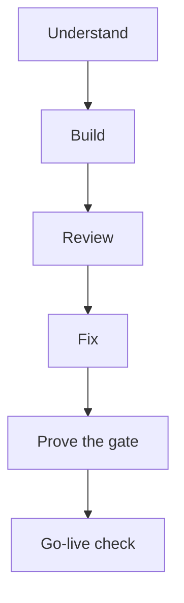

# A delivery cycle run by agents: understand, build, review, fix, prove the gate, go-live check

> I ran the build of a small private web app as six agent stages, each with separate roles, narrow file sets and hard rules, so that every claim had to carry evidence; the scripts hold the plans and prompts, not the outcomes.

## The problem

I wanted a small private web app behind a sign-in, built and checked largely by agents. Mistakes here were costly in three ways. A hole in the sign-in gate would expose private data to the internet. A sync job could damage a hand-kept data file that cannot be rebuilt. And a regression could break the local tool I use every day.

One agent building and then approving its own work would not do. I needed the work split into roles (mapper, researcher, builder, finder, skeptic, fixer, checker, attacker), each with a narrow job, and a rule that every claim comes with evidence.

## What runs

The app has four parts: a server that sits behind the sign-in, an export step that decides which data is published, a sync job on my own computer, and the page.

1. **Understand.** 9 read-only agents run in parallel. Five map the code and four research the hosting platform. Each returns a typed schema. Mappers must cite file and line for every claim and say "not found" instead of guessing; the server mapper had to return every route, 22 in all. Researchers must cite a primary source for each answer, give a confidence label, and say plainly if the docs contradict the premise. Every route and control gets a label for whether it is safe to expose remotely, so the build knows what to leave out.
2. **Build.** A written contract of six numbered interfaces is the single source of truth. Four builders work in parallel on disjoint file sets, so none can overwrite another. One integration checker then reads the seams between the parts and runs one offline end-to-end pass with fakes.
3. **Review.** Five adversarial lenses, each a finder followed by a skeptic for that lens. The skeptic must reproduce each finding before confirming it.
4. **Fix.** For each part, one builder applies a numbered list of decided fixes, then an independent checker verifies the result against a copy of every file taken before the fix.
5. **Prove the gate.** One agent writes a probe that checks an outsider with no sign-in gets nothing. The probe is then run in setups where it must fail as well as pass, reviewed by a coverage skeptic, fixed, and re-run by a fresh agent.
6. **Go-live check.** Three outsider attackers, each with a request budget, test the live address. A pre-commit scanner checks every file about to be committed for secrets and private data, and a last skeptic reads all the server code.

The generic form of the review stage is [adversarial-code-review.workflow.js](../scripts/adversarial-code-review.workflow.js). For the review pattern in more depth, see [07-multi-agent-review.md](07-multi-agent-review.md).

## What I measured

The scripts hold plans and prompts. They compute counts at run time, but no outcome is saved in the files: not how many findings were confirmed, not a final pass or fail, and not time or cost. The numbers below are limits and rules the agents had to meet, not results.

| Measure | Value | Date |
|---|---|---|
| Read-only agents in the understand stage | 9 | 2026-11-09 |
| Routes the server map had to cover | 22 (10 GET, 12 POST) | 2026-11-09 |
| Builders in parallel on disjoint files | 4 | not stated in the script |
| Review lenses, each a finder and a skeptic | 5 | not stated in the script |
| Existing tests of the sync job that had to keep passing during fixes | 26, on two Python versions | not stated in the script |
| Proof runs for the gate probe | eight | not stated in the script |
| Request budgets of the three outsider attackers | 450, 350 and 250 | not stated in the script |
| Request budget of the last skeptic | 60 | not stated in the script |
| Contract limits | 8 KB request body; 5000 waiting edits | not stated in the script |

## What broke, and the fixes I specified

The scripts hold the fix list as numbered instructions to builders. They do not record that any of these fixes was applied or that a checker marked it FIXED, so each fix below is a specification, not a confirmed change.

**The first builders were stopped before they finished.** They had already written the full test suites, but the source files were stubs or missing. I turned this into a tests-first handoff. Each new builder got a continuation note: read every test completely, then write the code so all tests pass. The rule was "The tests plus the written contract are the specification. Do not weaken or delete a test to make it pass." A test could change only where it contradicted the contract, and every such change had to be reported.

**A rate limit cost more than it saved.** The review reported that the limit on waiting edits read every waiting row on each request, so about 3,200 quick POSTs from one signed-in session could use up the free plan's daily database reads. The fix spec has it read one row instead. Because ids only grow, the estimate is never lower than the true count, so the limit can only get stricter. The acceptance rule was that one request visits at most 1 row however long the queue is.

**A single scrub pass could leave a new match.** Free text could carry a local file path into the published copy, and removing one match could create another. The fix spec has the scrub loop until nothing matches, scrub every value except the one key that must stay byte for byte, and read the output back after writing, emptying it on any match. The spec also states what the fix cannot do: free text with other personal details cannot be reliably scanned for.

**Failures were silent.** If another job was always running, the sync job deferred edits forever and still counted each run as good. The alert path was also mute: a helper reported "not sent" as a string that the job treated as delivered. The spec counts a deferral that lasts 6 hours as a failed run, so the existing alert rule fires after three such runs in a row. It also gives the job its own fixed-text desktop notification and limits alerts to at most one per 24 hours.

**A timed-out deploy could finish later.** When the deploy tool timed out, its child process kept running, so a hung deploy could publish an older snapshot afterwards. The spec has the tool start in its own session and the whole process group be killed on timeout or error, with a test that uses a stand-in tool whose child would write a marker file and asserts the marker never appears.

**The deploy tool behaved differently inside an agent's shell.** The review reported that it reads an environment variable that marks an AI agent's shell and, on a first deploy, changes account settings without asking. The spec has that variable removed from the tool's environment, with a comment and a test.

## Design choices

- **A written contract and disjoint files.** Four agents worked at the same moment without talking to each other. The contract fixed the layout, the API and the tables, and a later checker tested each seam. A builder that found a contract point wrong had to build the closest safe behaviour and report the deviation.
- **Fail closed.** With any sign-in setting missing, every route answers 503. The export uses an allow-list, so a field added later stays private until someone adds it on purpose.
- **Decided trade-offs and evidence.** The review prompt lists choices already made, so reviewers do not re-open them. Each finding needs evidence the reviewer produced: a script with its real output, or a file-and-line trace. "If you find nothing real, return an empty list - that is a valid result."
- **Skeptics reproduce, then look where the finder did not.** "When unsure, do not confirm." After the verdicts, each skeptic picks the two most dangerous things the finder did not really examine and examines them.
- **A checker who did not write the fix.** The checker diffs every changed line against the pre-fix copy, lists anything not asked for as an unasked change, re-runs the review's proof scripts, and marks a fix FIXED, PARTLY or NOT_FIXED only for what it saw itself.
- **Test the tester.** A probe that always says PASS is worthless. The plan runs it eight ways, including against a deliberately leaky server that serves the private folder; there it had to fail. A fresh agent that trusts no earlier report then repeats every run.
- **Reports must not leak.** Attackers and the probe never print private content. They compare inside a script and report only true or false, a status, a length or a hash prefix.
- **Budgeted outsiders.** Each attacker has a request cap, sends one request at a time, and must stop at once and report if it sees a real leak. Each must also say what it did not get to.
- **Model per stage.** From the build stage on, every agent call names its model. The stronger model goes where a wrong answer is expensive.

| Stage | Model |
|---|---|
| Understand | Sonnet for some mappers and researchers; the rest used the session default |
| Build | Opus for the server, sync and page builders and the integration checker; Sonnet for the export builder |
| Review | Opus for finders and skeptics |
| Fix | Sonnet builders for the server and export; Opus builders for sync and page; Opus for every checker |
| Prove the gate | Sonnet for the builder, the runs, the fixer and the fresh verifier; Opus for the coverage skeptic |
| Go-live check | Sonnet for the attackers and the scanner; Opus for the last skeptic |

## Limits

- The files are plans and prompts. They do not show how many findings were confirmed, whether every fix held, or how the go-live check ended, and I make no claim about any of that here.
- Apart from the stopped builders, the defects above come from the fix stage's list of decided fixes. That list shows what the review reported, not an independent measure of how good the review was.
- This is one small private app, built once. It does not show the cycle works at team scale or on a large codebase.
- Agents checked agents. Separate roles, reproduction rules and pre-fix diffs reduce self-grading, but they do not replace a human security review.
- The probe's proof runs used local stand-ins. Its behaviour on the real hosting edge was a question for the coverage skeptic, not something measured here.

## My part

I set the goal and the stakes, decided the six stages and the roles in each, made the design decisions the review was told to treat as settled, chose which fixes to make, set the request budgets and the safety rules, and chose the model for each stage. Claude Code wrote most of the code, the tests and the prompt text under my direction. The scripts were designed and run by me with Claude Code.
